## ChAIR-PIPEv2

##  Introduction
ChAIR-PIPEv2 processes the sequencing data (ChAIR) to generate single-cell contact, ATAC fragment, peak count matrix, gene expression matrix ......, bulk-cell contact matrix, chromatin loops, coverage signal, peak ...... . ChAIR-PIPEv2 includes module: linker calling, mapping, duplicate removing, loop calling and more.

## Usage
A ChAIR demo data from K562 was provided.<br/>
1. Prepare ChAIR data <br/>
```sh
wget https://download.cncb.ac.cn/gsa-human/HRA007068/HRR1686121/HRR1686121.tar.gz
wget https://download.cncb.ac.cn/gsa-human/HRA007068/HRR1686122/HRR1686122.tar.gz
tar zxf HRR1686121.tar.gz
tar zxf HRR1686122.tar.gz
mv K562_Rep1.DNA.R1_001.fastq.gz SCG0074-15872_SI-NA-D6_S5_L003_R1_001.fastq.gz
mv K562_Rep1.DNA.R2_001.fastq.gz SCG0074-15872_SI-NA-D6_S5_L003_R2_001.fastq.gz
mv K562_Rep1.DNA.R3_001.fastq.gz SCG0074-15872_SI-NA-D6_S5_L003_R3_001.fastq.gz
mv K562_Rep1.RNA.R1_001.fastq.gz SCG0081-15878_GTAACATGCG-AGGTAACACT_S1_L001_R1_001.fastq.gz
mv K562_Rep1.RNA.R2_001.fastq.gz SCG0081-15878_GTAACATGCG-AGGTAACACT_S1_L001_R2_001.fastq.gz

echo -e "$abspath/K562/data/SCG0074-15872_SI-NA-D6\t$abspath/K562/data/SCG0081-15878_GTAACATGCG-AGGTAACACT" > k562.input.list
```
2. Prepare genome <br/>
```sh
wget https://ftp.ebi.ac.uk/pub/databases/gencode/Gencode_human/release_32/GRCh38.p13.genome.fa.gz
gunzip GRCh38.p13.genome.fa.gz
singularity run chiav2.sif bwa index GRCh38.p13.genome.fa
```
3. Modify the information (submit_cpu10x_for_scChAIR.hg38.pro.sh) <br/>
```sh
addLinkerSeq='ATAGGCGCTGGTTGCGTTGT' # linker sequence
genome=hg38 # assembly name
ARCref=~/Tools/cellranger-arc-2.0.2/genome/refdata-cellranger-arc-GRCh38-2020-A-2.0.0 # cellranger-arc ref
GEXref=~/Tools/cellranger-7.1.0/genome/refdata-gex-GRCh38-2020-A # cellranger ref
ATACref=~/Tools/cellranger-atac-2.1.0/genome/refdata-cellranger-arc-GRCh38-2020-A-2.0.0 # cellranger-atac ref
bwaref=~/refs/hg38/bwa/hg38.fa # bwa ref
blacklist=~/hg38.blacklist.bed # or null # download from encode
genebed=~/Tools/cellranger-7.1.0/genome/refdata-gex-GRCh38-2020-A/genes/hg38.info # gene info # bed format

siffile="~/scChAIR/ChAIR.sif"
codepath="~/scChAIR/codes"
```
4. Execute program. <br/>
```sh
bash submit_cpu10x_for_scChAIR.hg38.pro.sh k562.input.list # abspath
```

## Example result
#### Data preprocessing to split out scRNA, scATAC, and scPET triomics data from ChAIR
[Statistical tables of data processing data](exampleData/SCG0074-15872_SI-NA-D6.hg38.bulk_stats.tsv)
<table>
  <tr>
    <th>item</th>
    <th>value</th>
    <th>process</th>
  </tr>
  <tr>
    <td>Library_ID</td>
    <td>SCG0074-15872_SI-NA-D6</td>
    <td rowspan="8">linker calling</td>
  </tr>
  <tr>
    <td>Genome_origin</td>
    <td>hg38</td>
  </tr>
  <tr>
    <td>DNA_raw_reads</td>
    <td>702,635,833</td>
  </tr>
  <tr>
    <td>DNA_raw_without_linker</td>
    <td>243,895,815</td>
  </tr>
  <tr>
    <td>DNA_linker_detected_reads</td>
    <td>458,740,018</td>
  </tr>
  <tr>
    <td>DNA_raw_2tag_with_linker</td>
    <td>162,207,570</td>
  </tr>
  <tr>
    <td>DNA_raw_1tag_with_linker</td>
    <td>292,893,616</td>
  </tr>
  <tr>
    <td>DNA_raw_others_with_linker</td>
    <td>3,638,832</td>
  </tr>
  <tr>
    <td>paired_reads/PET/2tag</td>
    <td>162,207,570</td>
    <td rowspan="42">Aligning</td>
  </tr>
  <tr>
    <td>PET_UU_all</td>
    <td>131,336,599</td>
  </tr>
  <tr>
    <td>PET_UU_mapped_q20</td>
    <td>116,510,134</td>
  </tr>
  <tr>
    <td>PET_UU_mapped_q20_validCB</td>
    <td>115,228,221</td>
  </tr>
  <tr>
    <td>PET_UU_mapped_q20_validCB_dedup</td>
    <td>14,838,493</td>
  </tr>
  <tr>
    <td>PET_UU_Redundancy</td>
    <td>87.1%</td>
  </tr>
  <tr>
    <td>PET_trans</td>
    <td>2,406,087</td>
  </tr>
  <tr>
    <td>PET_cis</td>
    <td>12,432,406</td>
  </tr>
  <tr>
    <td>PET_cis>1kb</td>
    <td>8,296,510</td>
  </tr>
  <tr>
    <td>PET_cis>8kb</td>
    <td>5,071,606</td>
  </tr>
  <tr>
    <td>PET_ratio_cis/trans</td>
    <td>5.17</td>
  </tr>
  <tr>
    <td>PET_ratio_cis>1kb/trans</td>
    <td>3.45</td>
  </tr>
  <tr>
    <td>PET_UxxU_all</td>
    <td>27,313,061</td>
  </tr>
  <tr>
    <td>PET_UxxU_mapped_q20</td>
    <td>24,781,796</td>
  </tr>
  <tr>
    <td>PET_UxxU_mapped_q20_validCB</td>
    <td>24,401,020</td>
  </tr>
  <tr>
    <td>PET_UxxU_mapped_q20_validCB_dedup</td>
    <td>4,040,848</td>
  </tr>
  <tr>
    <td>PET_UxxU_Redundancy</td>
    <td>83.4%</td>
  </tr>
  <tr>
    <td>single_reads</td>
    <td>292,772,563</td>
  </tr>
  <tr>
    <td>single_UxxU_all</td>
    <td>284,289,918</td>
  </tr>
  <tr>
    <td>single_UxxU_mapped_q20</td>
    <td>276,839,957</td>
  </tr>
  <tr>
    <td>single_UxxU_mapped_q20_validCB</td>
    <td>273,549,428</td>
  </tr>
  <tr>
    <td>single_UxxU_mapped_q20_validCB_dedup</td>
    <td>43,001,852</td>
  </tr>
  <tr>
    <td>single_UxxU_Redundancy</td>
    <td>84.3%</td>
  </tr>
  <tr>
    <td>NoLinker_reads</td>
    <td>243,894,375</td>
  </tr>
  <tr>
    <td>NoLinker_UU_all</td>
    <td>228,014,633</td>
  </tr>
  <tr>
    <td>NoLinker_UU_mapped_q20</td>
    <td>220,126,702</td>
  </tr>
  <tr>
    <td>NoLinker_UU_mapped_q20_validCB</td>
    <td>217,394,414</td>
  </tr>
  <tr>
    <td>NoLinker_UU_mapped_q20_validCB_dedup</td>
    <td>37,089,562</td>
  </tr>
  <tr>
    <td>NoLinker_UU_Redundancy</td>
    <td>82.9%</td>
  </tr>
  <tr>
    <td>NoLinker_UU_PET</td>
    <td>4,463,191</td>
  </tr>
  <tr>
    <td>NoLinker_trans</td>
    <td>1,028,367</td>
  </tr>
  <tr>
    <td>NoLinker_cis</td>
    <td>3,434,824</td>
  </tr>
  <tr>
    <td>NoLinker_cis>1kb</td>
    <td>3,434,824</td>
  </tr>
  <tr>
    <td>NoLinker_cis>8kb</td>
    <td>1,904,430</td>
  </tr>
  <tr>
    <td>NoLinker_ratio_cis/trans</td>
    <td>3.34</td>
  </tr>
  <tr>
    <td>NoLinker_ratio_cis>1kb/trans</td>
    <td>3.34</td>
  </tr>
  <tr>
    <td>NoLinker_UxxU_all</td>
    <td>8,891,695</td>
  </tr>
  <tr>
    <td>NoLinker_UxxU_mapped_q20</td>
    <td>5,843,642</td>
  </tr>
  <tr>
    <td>NoLinker_UxxU_mapped_q20_validCB</td>
    <td>4,571,190</td>
  </tr>
  <tr>
    <td>NoLinker_UxxU_mapped_q20_validCB_dedup</td>
    <td>2,130,819</td>
  </tr>
  <tr>
    <td>NoLinker_UxxU_Redundancy</td>
    <td>53.4%</td>
  </tr>
  <tr>
    <td>Average_Redundancy</td>
    <td>84.08%</td>
  </tr>
  <tr>
    <td>all_pet</td>
    <td>19,301,684</td>
    <td rowspan="31">scPET</td>
  </tr>
  <tr>
    <td>all_trans</td>
    <td>3,434,454</td>
  </tr>
  <tr>
    <td>all_cis</td>
    <td>15,867,230</td>
  </tr>
  <tr>
    <td>all_cis>1kb</td>
    <td>11,731,334</td>
  </tr>
  <tr>
    <td>all_cis>8kb</td>
    <td>6,976,036</td>
  </tr>
  <tr>
    <td>all_ratio_cis/trans</td>
    <td>4.62</td>
  </tr>
  <tr>
    <td>all_ratio_cis>1kb/trans</td>
    <td>3.42</td>
  </tr>
  <tr>
    <td>PET_cluster</td>
    <td>501,696</td>
  </tr>
  <tr>
    <td>Intra-chr_PET_cluster</td>
    <td>380,586</td>
  </tr>
  <tr>
    <td>pets_number_2</td>
    <td>338,734</td>
  </tr>
  <tr>
    <td>pets_number_3</td>
    <td>30,130</td>
  </tr>
  <tr>
    <td>pets_number_4</td>
    <td>6,647</td>
  </tr>
  <tr>
    <td>pets_number_5</td>
    <td>2,283</td>
  </tr>
  <tr>
    <td>pets_number_6</td>
    <td>1,047</td>
  </tr>
  <tr>
    <td>pets_number_7</td>
    <td>560</td>
  </tr>
  <tr>
    <td>pets_number_8</td>
    <td>319</td>
  </tr>
  <tr>
    <td>pets_number_9</td>
    <td>212</td>
  </tr>
  <tr>
    <td>pets_number_10</td>
    <td>162</td>
  </tr>
  <tr>
    <td>pets_number>10</td>
    <td>492</td>
  </tr>
  <tr>
    <td>Inter-chr_PET_cluster</td>
    <td>121,110</td>
  </tr>
  <tr>
    <td>pets_number_2</td>
    <td>115,580</td>
  </tr>
  <tr>
    <td>pets_number_3</td>
    <td>4,774</td>
  </tr>
  <tr>
    <td>pets_number_4</td>
    <td>580</td>
  </tr>
  <tr>
    <td>pets_number_5</td>
    <td>113</td>
  </tr>
  <tr>
    <td>pets_number_6</td>
    <td>40</td>
  </tr>
  <tr>
    <td>pets_number_7</td>
    <td>7</td>
  </tr>
  <tr>
    <td>pets_number_8</td>
    <td>2</td>
  </tr>
  <tr>
    <td>pets_number_9</td>
    <td>1</td>
  </tr>
  <tr>
    <td>pets_number_10</td>
    <td>1</td>
  </tr>
  <tr>
    <td>pets_number>10</td>
    <td>12</td>
  </tr>
  <tr>
    <td>Significant_interaction</td>
    <td>41,734</td>
  </tr>
  <tr>
    <td>RNA_raw_reads</td>
    <td>230,928,581</td>
    <td rowspan="7">scRNA</td>
  </tr>
  <tr>
    <td>RNA_barcode</td>
    <td>97.3%</td>
  </tr>
  <tr>
    <td>RNA_mapped_ratio</td>
    <td>92.9%</td>
  </tr>
  <tr>
    <td>RNA_overlap_gene</td>
    <td>27,366</td>
  </tr>
  <tr>
    <td>RNA_Estimated_cells</td>
    <td>6,535</td>
  </tr>
  <tr>
    <td>RNA_UMI</td>
    <td>5,907</td>
  </tr>
  <tr>
    <td>RNA_nGeneFeature</td>
    <td>2,798</td>
  </tr>
  <tr>
    <td>ATAC_Peak</td>
    <td>53,238</td>
    <td rowspan="9">scATAC</td>
  </tr>
  <tr>
    <td>ATAC_Fragment</td>
    <td>116,643,490</td>
  </tr>
  <tr>
    <td>ATAC_Barcode</td>
    <td>388,507</td>
  </tr>
  <tr>
    <td>ATAC_Estimated_cells</td>
    <td>4,382</td>
  </tr>
  <tr>
    <td>ATAC_doublet_rate</td>
    <td>0.0073</td>
  </tr>
  <tr>
    <td>ATAC_fragment_in_peaks_rate</td>
    <td>0.0562</td>
  </tr>
  <tr>
    <td>ATAC_fragment_overlapping_peaks_rate</td>
    <td>0.0721</td>
  </tr>
  <tr>
    <td>ATAC_fragment_overlapping_TSS_rate</td>
    <td>0.1130</td>
  </tr>
  <tr>
    <td>ATAC_median_fragment_count_percell</td>
    <td>18160.5</td>
  </tr>
</table>

1. data stat
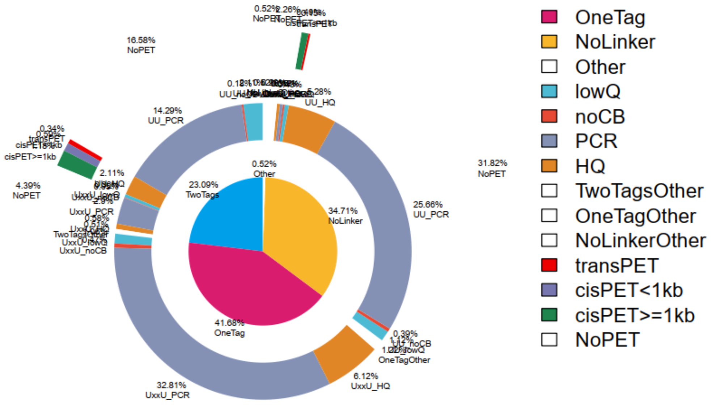

2. align insert size
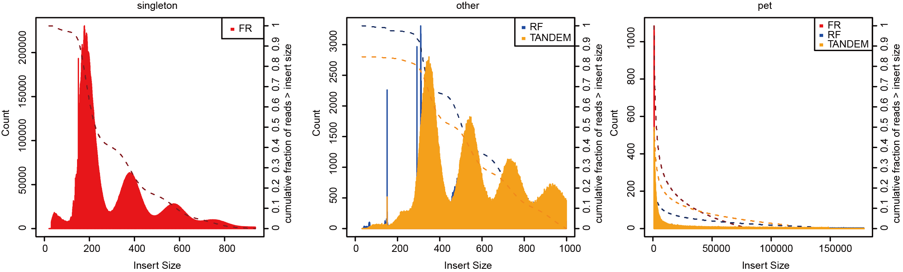
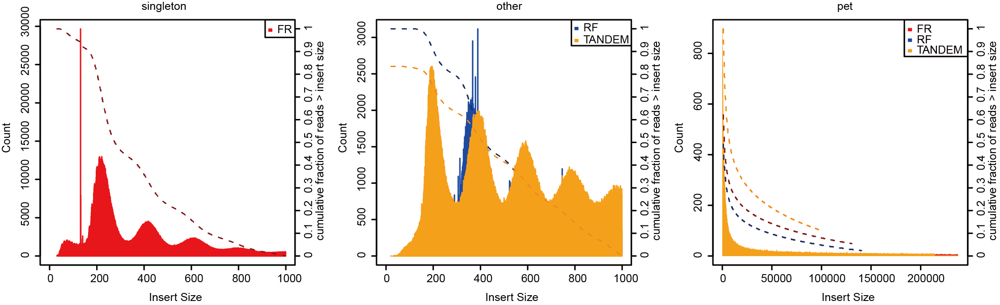

3. profile
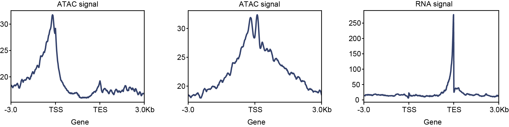

4. PET count distribution for loops
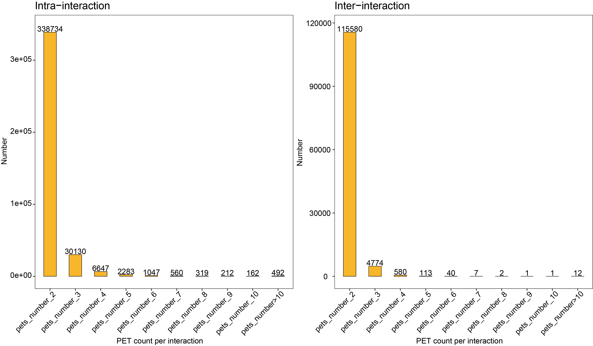

5. 2D contact and loops
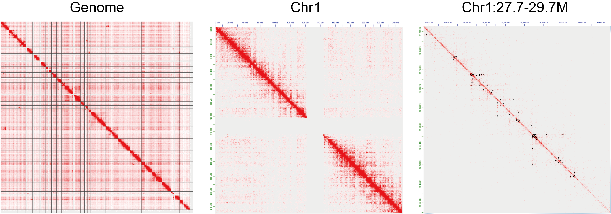

6. ATAC fragment length distribution
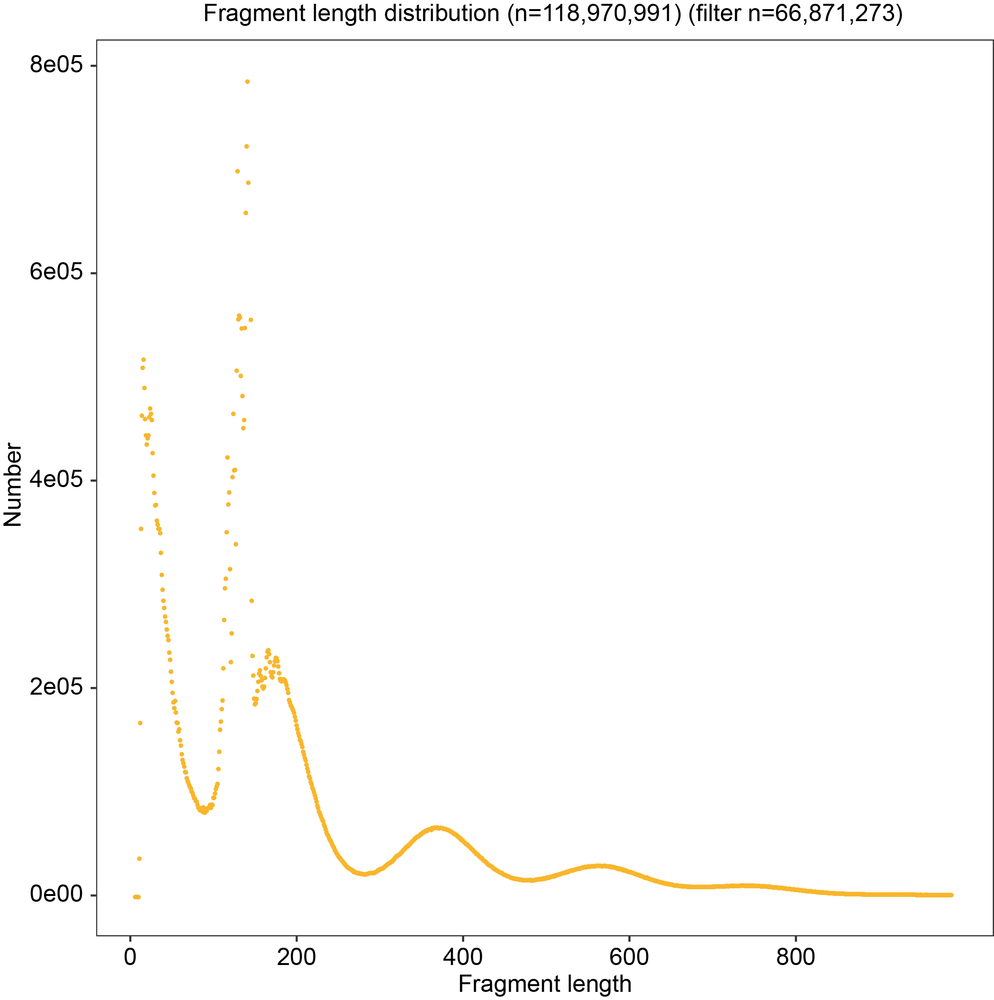

7. barcode rank plot
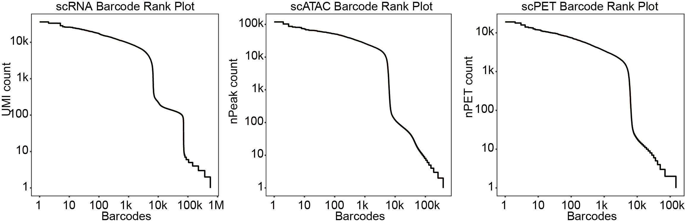<br>
[scRNA barcode rank plot](img/SCG0074-15872_SI-NA-D6.barcodeRankPlot.pdf.scRNA.html)             [scATAC barcode rank plot](img/SCG0074-15872_SI-NA-D6.barcodeRankPlot.pdf.scATAC.html)             [scPET barcode rank plot](img/SCG0074-15872_SI-NA-D6.barcodeRankPlot.pdf.scPET.html)

8. barcodeStat in trip-omic
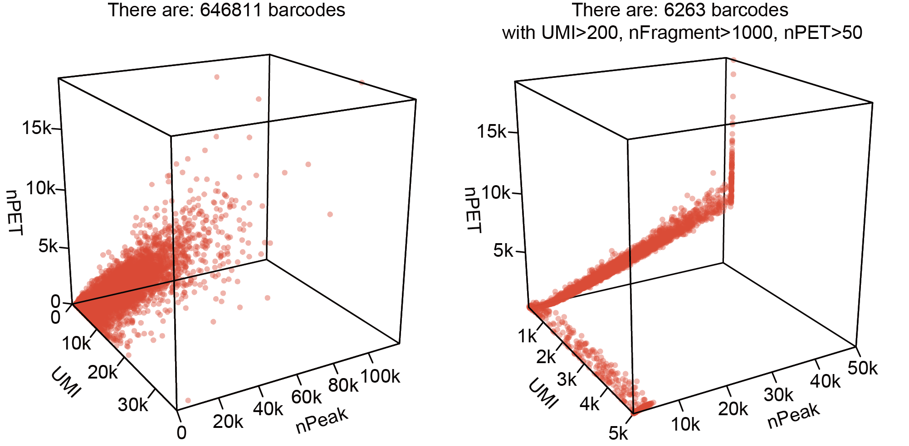

#### Single-Cell analysis
1. doublet remove
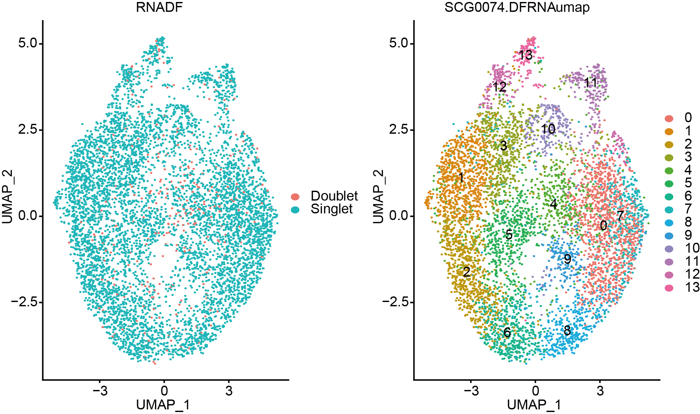

2. cell data stat
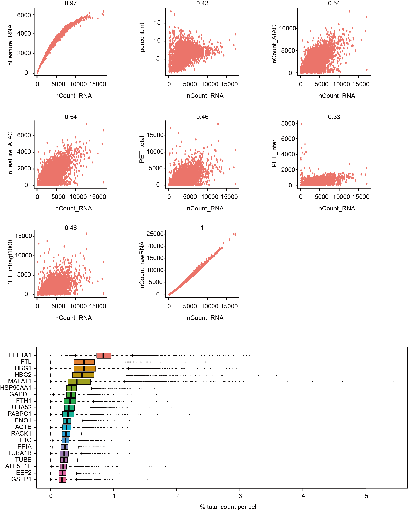