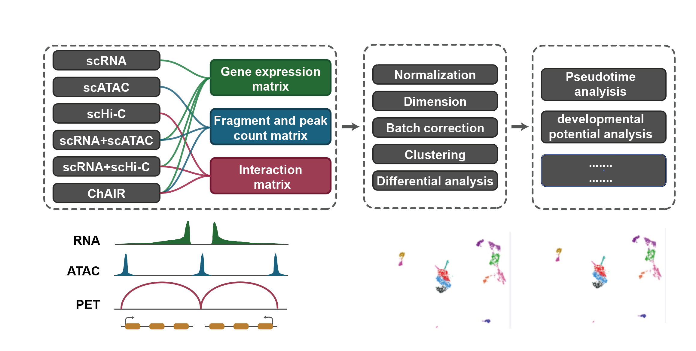
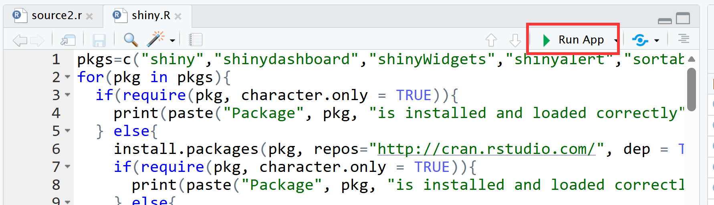
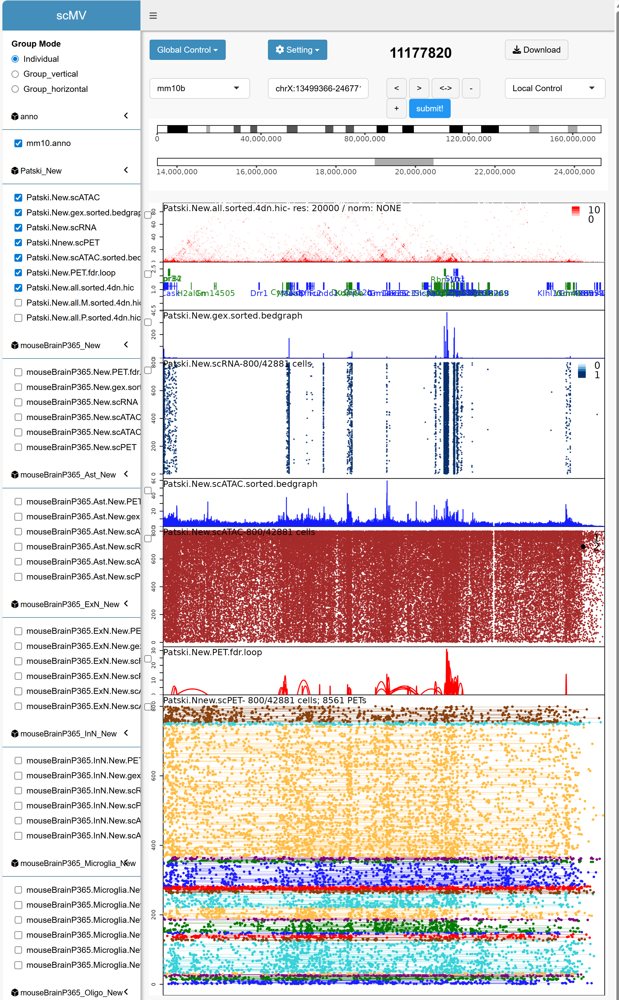

## ChAIR

Schematics of ChAIR procedure to generate ChAIR-RNA, -ATAC, and -PET datasets in single cells. In ChAIR, crosslinked cells are manipulated through in situ restriction digestion, proximity ligation, and Tn5 tagmentation. The processed cells are then individually encapsulated into droplets using the 10x Genomics Multiome system, which barcodes DNA and RNA molecules simultaneously. The corresponding DNA and RNA information is obtained through DNA sequencing. ChAIR data contain two library data (ChIATAC-DNA and cDNA) or three library data (ChIATAC-DNA, ATAC-DNA and cDNA). If you use ChAIR, please cite :

Chai, H., Huang, X., Xiong, G. et al. Tri-omic single-cell mapping of the 3D epigenome and transcriptome in whole mouse brains throughout the lifespan. Nat Methods 22, 994–1007 (2025). [https://doi.org/10.1038/s41592-025-02658-7](https://doi.org/10.1038/s41592-025-02658-7)

## scMAV
single-cell multi-omic analysis and visualization tools.

The <strong>core components</strong> of data processing have been uploaded to DockerHub to avoid tedious software installation. <br/>
**DockerHub Link: [https://hub.docker.com/repository/docker/fengchuiguo1994/scMAV:tagsname](https://hub.docker.com/repository/docker/fengchuiguo1994/scMAV)



## [System Requirements](https://sylabs.io/guides/3.8/admin-guide/installation.html)
#### Hardware
scMAV should be run on a Linux system that meets the following requirements:
* 8-core Intel or AMD processor (>20 cores recommended)
* 64GB RAM (>320GB recommended)
* 64-bit CentOS/RedHat 7.8 or Ubuntu 20.04

#### Software
* Singularity: a container platform, >=3.8

#### Quick installation of Singularity
```
## On Red Hat Enterprise Linux or CentOS install the following dependencies:
$ sudo yum update -y && sudo yum groupinstall -y 'Development Tools' && sudo yum install -y openssl-devel libuuid-devel libseccomp-devel wget squashfs-tools cryptsetup

## On Ubuntu or Debian install the following dependencies:
$ sudo apt-get update && sudo apt-get install -y build-essential uuid-dev libgpgme-dev squashfs-tools libseccomp-dev wget pkg-config git cryptsetup-bin

## Install Go
$ export VERSION=1.14.12 OS=linux ARCH=amd64 && wget https://dl.google.com/go/go$VERSION.$OS-$ARCH.tar.gz && sudo tar -C /usr/local -xzvf go$VERSION.$OS-$ARCH.tar.gz && rm go$VERSION.$OS-$ARCH.tar.gz

$ echo 'export GOPATH=${HOME}/go' >> ~/.bashrc && echo 'export PATH=/usr/local/go/bin:${PATH}:${GOPATH}/bin' >> ~/.bashrc && source ~/.bashrc

## Install singularity on CentOS without compile
$ yum install -y singularity
```

#### Quick download scMAV from DockerHub
You can download scMAV by running the following command:
```
singularity build scMAV.sif docker://fengchuiguo1994/scMAV:v1
```

------------


## Single-cell multi-omics dimensionality reduction and clustering results were generated using SCMAV.

#### 1. Download ChAIR data and prepare the input files
```
wget ftp://download.big.ac.cn/gsa4/CRA015673/CRR1544967/CRR1544967.tar.gz
wget ftp://download.big.ac.cn/gsa4/CRA015673/CRR1544966/CRR1544966.tar.gz
wget ftp://download.big.ac.cn/gsa4/CRA015673/CRR1544965/CRR1544965.tar.gz
tar zxf CRR1544967.tar.gz
tar zxf CRR1544966.tar.gz
tar zxf CRR1544965.tar.gz
cp mouseBrainP365_chairV2_Rep1.RNA.R1_001.fastq.gz MOSCCA0015-15878_GTAACATGCG-AGGTAACACT_S1_L001_R1_001.fastq.gz
cp mouseBrainP365_chairV2_Rep1.RNA.R2_001.fastq.gz MOSCCA0015-15878_GTAACATGCG-AGGTAACACT_S1_L001_R2_001.fastq.gz

cat mouseBrainP365_chairV2_Rep1.ATAC.R1_001.fastq.gz mouseBrainP365_chairV2_Rep1.ChIATAC.R1_001.fastq.gz > MOSCCA0020-15872_SI-NA-D6_S5_L003_R1_001.fastq.gz
cat mouseBrainP365_chairV2_Rep1.ATAC.R2_001.fastq.gz mouseBrainP365_chairV2_Rep1.ChIATAC.R2_001.fastq.gz > MOSCCA0020-15872_SI-NA-D6_S5_L003_R2_001.fastq.gz
cat mouseBrainP365_chairV2_Rep1.ATAC.R3_001.fastq.gz mouseBrainP365_chairV2_Rep1.ChIATAC.R3_001.fastq.gz > MOSCCA0020-15872_SI-NA-D6_S5_L003_R3_001.fastq.gz

# Create a sample manifest file that lists the FASTQ file paths and defines the output prefix/path for the analysis. (like input.txt):
# RNAbarcode RNAfastq DNAbarcode DNAfastq1 DNAfastq2 outputdir outputprefix

# Create a configuration file for the analysis workflow. It should define the software tools to be used, the path to the genome index, and the compute cluster queue settings. (like config10Xcustomslurm.txt)
```

#### 2. Process ChAIR data in SCMAV
```
# Run in SLURM server mode.
sbatch -p cpu -J sh.run -o sh.run.out -e sh.run.err -N 1 -n 10 --mem=100G --wrap=" bash /data/SCMAV/mainPro.sh config10Xcustomslurm.txt input.txt "

# Run in local mode.
bash /data/SCMAV/mainPro.sh config10Xcustomlocal.txt input.txt
```

#### 3. Single-cell multi-omics dimensionality reduction and clustering results were generated using SCMAV.
```
# Single-cell expression matrices were loaded, followed by the filtration of low-quality and doublet cells.
Rscript prepareData.R

# Dimensionality reduction and clustering were conducted separately for each of the three omics modalities (RNA, ATAC, and PET), followed by the generation of a consolidated clustering result integrating all omics data.
Rscript analysis.R

# A reference procedure for cell type annotation.
Rscript annotation2.R
```


## Processing of Multi-Sample Data
Gene and interaction from RNA and PET assays are shared universally across samples, while ATAC peak regions exhibit variability with the sample composition. Accordingly, two strategies are available: 1) Employing tools such as ArchR that operate solely on fragment files. 2) Employing tools such as Signac that utilize both fragment and peak files as input. A  guide for Signac is provided here.
#### 1. Merge the ATAC-seq BAM files across multiple samples.
```
python /data/SCMAV/script/catSampleBam.py SCG0088/DNAalign/SCG0088.FRlt.bam,SCG0089/DNAalign/SCG0089.FRlt.bam,SCG0090/DNAalign/SCG0090.FRlt.bam,SCG0091/DNAalign/SCG0091.FRlt.bam,SCG0092/DNAalign/SCG0092.FRlt.bam,SCG0093/DNAalign/SCG0093.FRlt.bam SCG0088,SCG0089,SCG0090,SCG0091,SCG0092,SCG0093 patski.FRlt.bam
python /data/SCMAV/script/catSampleBam.py SCG0088/DNAalign/SCG0088.scPET.bam,SCG0089/DNAalign/SCG0089.scPET.bam,SCG0090/DNAalign/SCG0090.scPET.bam,SCG0091/DNAalign/SCG0091.scPET.bam,SCG0092/DNAalign/SCG0092.scPET.bam,SCG0093/DNAalign/SCG0093.scPET.bam SCG0088,SCG0089,SCG0090,SCG0091,SCG0092,SCG0093 patski.scPET.bam
python /data/SCMAV/script/catSampleBam.py SCG0088.gex.bam,SCG0089.gex.bam,SCG0090.gex.bam,SCG0091.gex.bam,SCG0092.gex.bam,SCG0093.gex.bam SCG0088,SCG0089,SCG0090,SCG0091,SCG0092,SCG0093 patski.gex.bam
samtools sort -@ 10 -o patski.FRlt.sorted.bam patski.FRlt.bam
samtools sort -@ 10 -o patski.scPET.sorted.bam patski.scPET.bam
samtools merge -@ 10 -o patski.scATAC.sorted.bam patski.FRlt.sorted.bam patski.scPET.sorted.bam

macs2 callpeak -f BAM --keep-dup all --nomodel --shift -75 --extsize 150 -B --SPMR -t patski.scATAC.sorted.bam -g mm -n patski.scATAC --qvalue 0.001
awk '$7+0.0 > 2' patski.scATAC_peaks.narrowPeak | grep -v -i "chrM" | cut -f 1-3 > patski.scATAC.peak
```

#### 2. The scATAC peak matrix was recalculated separately for each sample.
```
for i in SCG0088 SCG0089 SCG0090 SCG0091 SCG0092 SCG0093; do
    mkdir -p patskiATAC/${i}/raw_matrix
    python /data/SCMAV/script/getMat.py patski.scATAC.peak ${i}/fragment/${i}_fragments.tsv.gz patskiATAC/${i}/raw_matrix/features.tsv patskiATAC/${i}/raw_matrix/barcodes.tsv patskiATAC/${i}/raw_matrix/matrix.mtx
    pigz -f -p 10 patskiATAC/${i}/raw_matrix/features.tsv patskiATAC/${i}/raw_matrix/matrix.mtx patskiATAC/${i}/raw_matrix/barcodes.tsv
done
```
Subsequently, standard processing steps—including data merge, filtering, dimensionality reduction, and clustering—were applied to the single-cell data.


## Allele specific analysis
```
python /data/SCMAV/script/findAlleleReadsbyMD.py -a /data/SCMAV/SNP/patski.merge.hap.txt.gz -i patski.FRlt.bam -o patski.FRlt.allele.byMD.bam -q 20 > patski.FRlt.allele.byMD.bam.log
python /data/SCMAV/script/findAlleleReadsbyMD.py -a /data/SCMAV/SNP/patski.merge.hap.txt.gz -i patski.scPET.bam -o patski.scPET.allele.byMD.bam -q 20 > patski.scPET.allele.byMD.bam.log
python /data/SCMAV/script/findAlleleReadsbypileup.py /data/SCMAV/SNP/patski.merge.hap.txt.gz patski.gex.bam patski.gex.allele.bam > patski.gex.allele.bam.log

python /data/SCMAV/script/filterAlleleBamSingle.py -i patski.gex.allele.bam -o patski.gex.allele > patski.gex.allele.flt.log
python /data/SCMAV/script/filterAlleleBamPET.py -i patski.scPET.allele.byMD.bam -o patski.scPET.allele > patski.scPET.allele.flt.log
python /data/SCMAV/script/filterAlleleBamPET.py -i patski.FRlt.allele.byMD.bam -o patski.FRlt.allele > patski.FRlt.allele.flt.log
```


## Visualization (genome browser in Rshiny) in SCMAV
###### 1. install mariadb or mysql
```
wget http://repo.mysql.com/mysql-community-release-el7-5.noarch.rpm
rpm -ivh mysql-community-release-el7-5.noarch.rpm
yum update
yum install mysql-server
chown -R mysql:mysql /var/lib/mysql/
mysqld --initialize
systemctl start mysqld
systemctl status mysqld


yum install mariadb-server mariadb 
systemctl start mariadb
systemctl enable mariadb
```
###### 2. load a genome assembly to mysql
```
mkdir /home/binarypath
python uploadSQLPro.py addGenome -d mm10b -s genomedir/mm10.size.txt
python uploadSQLPro.py addTrack -i genomedir/mm10.chrband.txt -d mm10b -p anno -n mm10.chrband -f chrband
python uploadSQLPro.py addTrack -i genomedir/mm10.genome.bed -d mm10b -p anno -n mm10.anno -f anno
```
###### 3. load data
```
python uploadSQLPro.py addTrack -i mouseBrainP365dir/mouseBrainP365.PET.fdr.loops -d mm10b -p mouseBrainP365_New -n mouseBrainP365.New.PET.fdr.loop -f loop
python uploadSQLPro.py addTrack -i mouseBrainP365dir/mouseBrainP365.gex.RPKM.bedgraph -d mm10b -p mouseBrainP365_New -n mouseBrainP365.New.gex.sorted.bedgraph -f bedgraph
# python uploadSQLPro.py addTrack -i mouseBrainP365dir/mouseBrainP365.ATAC.RPKM.bedgraph -d mm10b -p mouseBrainP365_New -n mouseBrainP365.New.scATAC.sorted.bedgraph -f bedgraph

python uploadSQLPro.py addTrack -i mouseBrainP365dir/mouseBrainP365.scATAC.all.fragment -d mm10b -p mouseBrainP365_New -n mouseBrainP365.New.scATAC -f scATAC
python uploadSQLPro.py addTrack -i mouseBrainP365dir/mouseBrainP365.bedpe.all.gex -d mm10b -p mouseBrainP365_New -n mouseBrainP365.New.scRNA -f scRNA
python uploadSQLPro.py addTrack -i mouseBrainP365dir/mouseBrainP365.scPET.all.bedpe -d mm10b -p mouseBrainP365_New -n mouseBrainP365.New.scPET -f scPET
```
###### 4. genome browser start


###### 5. viewer

