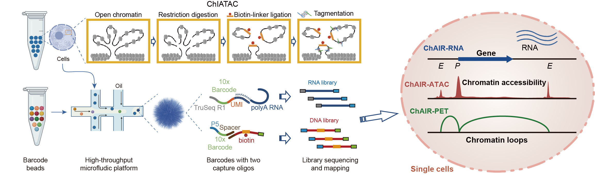
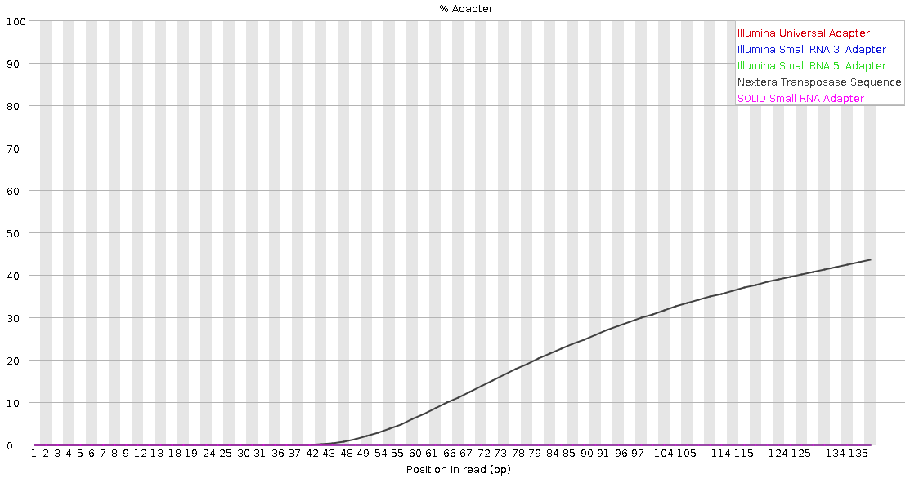

## ChAIR library

Schematics of ChAIR procedure to generate ChAIR-RNA, -ATAC, and -PET datasets in single cells. In ChAIR, crosslinked cells are manipulated through in situ restriction digestion, proximity ligation, and Tn5 tagmentation. The processed cells are then individually encapsulated into droplets using the 10x Genomics Multiome system, which barcodes DNA and RNA molecules simultaneously. The corresponding DNA and RNA information is obtained through DNA sequencing. ChAIR data contain two library data (ChIATAC-DNA and cDNA) or three library data (ChIATAC-DNA, ATAC-DNA and cDNA). 

## SCMAV
single-cell multi-omic analysis and visualization tools. SCMAV contain a <strong>[ChAIR-PIPEv2](ChAIR-PIPEv2)</strong>, <strong>[ChIA-PIPEv2](ChIA-PIPEv2)</strong>, <strong>[SCMAV](SCMAV)</strong>, <strong>ChAIR-View ([shiny version](ChAIR-View-shiny) and [local version](ChAIR-View-local))</strong> and <strong>[basic browser](basic-browser)</strong>. <br/>

The <strong>core components</strong> of data processing have been uploaded to DockerHub to avoid tedious software installation. <br/>
**DockerHub Link: [https://hub.docker.com/repository/docker/fengchuiguo1994/scmav:tagsname](https://hub.docker.com/repository/docker/fengchuiguo1994/scmav)

## [System Requirements](https://sylabs.io/guides/3.8/admin-guide/installation.html)
#### Hardware
SCMAV should be run on a Linux system that meets the following requirements:
* 8-core Intel or AMD processor (>20 cores recommended)
* 64GB RAM (>320GB recommended)
* 64-bit CentOS/RedHat 7.8 or Ubuntu 20.04

#### Software
* Singularity: a container platform, >=3.8

#### Quick installation of Singularity
```
## On Red Hat Enterprise Linux or CentOS install the following dependencies:
$ sudo yum update -y && sudo yum groupinstall -y 'Development Tools' && sudo yum install -y openssl-devel libuuid-devel libseccomp-devel wget squashfs-tools cryptsetup

## On Ubuntu or Debian install the following dependencies:
$ sudo apt-get update && sudo apt-get install -y build-essential uuid-dev libgpgme-dev squashfs-tools libseccomp-dev wget pkg-config git cryptsetup-bin

## Install Go
$ export VERSION=1.14.12 OS=linux ARCH=amd64 && wget https://dl.google.com/go/go$VERSION.$OS-$ARCH.tar.gz && sudo tar -C /usr/local -xzvf go$VERSION.$OS-$ARCH.tar.gz && rm go$VERSION.$OS-$ARCH.tar.gz

$ echo 'export GOPATH=${HOME}/go' >> ~/.bashrc && echo 'export PATH=/usr/local/go/bin:${PATH}:${GOPATH}/bin' >> ~/.bashrc && source ~/.bashrc

## Install singularity on CentOS without compile
$ yum install -y singularity
```

#### Quick download SCMAV from DockerHub
You can download SCMAV by running the following command:
```
singularity build scmav.sif docker://fengchuiguo1994/scmav:v1
```

## ChIATAC analysis
#### 1. Trim Nextera Transposase Sequence
<br/>
<p align="center">generate by FastQC</p><br/>
ChIATAC/ChAIR-DNA/ATAC data's end always has Nextera Transposase Sequence. The Nextera Transposase Sequence is removed by using Trimmomatic.<br/>
```shell
LEADING:5 TRAILING:5 ILLUMINACLIP:${trimmomaticpath}/adapters/NexteraPE-PE.fa:2:30:7:8:true MINLEN:30
```

- linker calling
