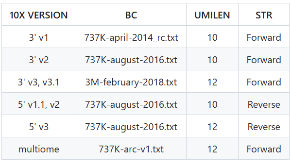

# STARsolo

singleCellTK
SCTK-QC
https://www.nature.com/articles/s41467-022-29212-9
在 STAR 的 2.7 版本中 (2.7.6a) 出现了 STARsolo，可以进行单细胞数据的比对
需要注意 ReadFilesIn 先读入测序数据，再读入 barcode+UMI 文件，即先读入 R2 再读入 R1

#### code
[ref1](https://cloud.tencent.com/developer/article/2366729), [ref2](https://zhuanlan.zhihu.com/p/362727395)
```
## index
STAR --runThreadN 10 --runMode genomeGenerate --genomeDir /data/users/Alignment/index/mm10 --genomeFastaFiles /data/users/Alignment/mm10/mm10.fa --sjdbGTFfile /data/users/Alignment/mm10/mm10.gtf
```

10X barcode


```
## align
STAR --runThreadN 10 --genomeDir /data/users/Alignment/index/mm10 --readFilesIn $R1 $R2 
--runDirPerm All_RWX $GZIP $BAM --soloBarcodeMate 1 --clip5pNbases 39 0 --soloType CB_UMI_Simple --soloCBwhitelist $BC --soloCBstart 1 --soloCBlen $CBLEN --soloUMIstart $((CBLEN+1)) --soloUMIlen $UMILEN --soloStrand Forward --soloUMIdedup 1MM_CR --soloCBmatchWLtype 1MM_multi_Nbase_pseudocounts --soloUMIfiltering MultiGeneUMI_CR --soloCellFilter EmptyDrops_CR 
--outFilterScoreMin 30 
--soloFeatures Gene Velocyto 
--soloOutFileNames output/ features.tsv barcodes.tsv matrix.mtx --soloMultiMappers EM --outReadsUnmapped Fastx


STAR --runThreadN 10 --soloType CB_UMI_Simple --soloFeatures Gene Velocyto --soloCBstart 1 --soloCBlen 16 --soloUMIstart 17 --soloUMIlen 12 --soloBarcodeReadLength 0 --readFilesCommand zcat --outSAMtype BAM SortedByCoordinate --outSAMattributes NH HI AS nM CR CY UR UY --soloOutFileNames Solo.out/ genes.tsv barcodes.tsv matrix.mtx --outFileNamePrefix ./out --genomeDir index/mm10 --soloCBwhitelist /software/STAR/BC/3M-february-2018.txt --readFilesIn CRRXXX_r2.fastq.gz CRRXXX_f1.fastq.gz

STAR  --genomeDir ghg38/ --readFilesCommand zcat --readFilesIn SRR7722939/SRR7722939_S1_L001_R2_001.fastq.gz SRR7722939/SRR7722939_S1_L001_R1_001.fastq.gz --soloType CB_UMI_Simple --soloCBwhitelist whitelist --runThreadN 8


我的是ICELL8平台测序，所用的命令如下。。
STAR --genomeDir /data/users/minmingw/Alignment/index --readFilesIn SRR11050949_2.fastq SRR11050949_1.fastq --soloCBwhitelist None --runThreadN 8 --soloType CB_UMI_Simple --soloCBstart 1 --soloCBlen 11 --soloUMIstart 12 --soloUMIlen 10 --soloBarcodeReadLength 26 --outSAMattributes NH HI nM AS CR UR CB UB GX GN sS sQ sM --outSAMtype BAM SortedByCoordinate --soloCellFilter EmptyDrops_CR --outFileNamePrefix SRR11050949
多个Lane: 注意fastq之间的空格
STAR --genomeDir /data/users/minmingw/Alignment/index --readFilesIn Chip91497_lane1_2.fastq,Chip91497_lane2_2.fastq,Chip91497_lane3_2.fastq Chip91497_lane1_1.fastq,Chip91497_lane2_1.fastq,Chip91497_lane3_1.fastq --soloCBwhitelist None --runThreadN 8 --soloType CB_UMI_Simple --soloCBstart 1 --soloCBlen 11 --soloUMIstart 12 --soloUMIlen 10 --soloBarcodeReadLength 26 --outSAMattributes NH HI nM AS CR UR CB UB GX GN sS sQ sM --outSAMtype BAM SortedByCoordinate --soloCellFilter EmptyDrops_CR --outFileNamePrefix Chip91497
```
##  Introduction
chiav2 processes the sequencing data (ChIATAC/ChIA-PET/Bridge-linker Hi-C) to generate chromatin loops, coverage signal and contact matrix. chiaV2 includes linker calling, mapping, duplicate removing, loop calling. It also contain the software for Hi-C analysis.

##  [System Requirements](https://sylabs.io/guides/3.8/admin-guide/installation.html)
###   Hardware
ChiaV2 should be run on a Linux system that meets the following requirements:
* 4-core Intel or AMD processor (>12 cores recommended)
* 64GB RAM (>256GB recommended)
* 64-bit CentOS/RedHat 7.8 or Ubuntu 20.04

###   Software
* Singularity: a container platform, >=3.8

####   Quick installation of Singularity
```
## On Red Hat Enterprise Linux or CentOS install the following dependencies:
$ sudo yum update -y && \
     sudo yum groupinstall -y 'Development Tools' && \
     sudo yum install -y \
     openssl-devel \
     libuuid-devel \
     libseccomp-devel \
     wget \
     squashfs-tools \
     cryptsetup

## On Ubuntu or Debian install the following dependencies:
$ sudo apt-get update && sudo apt-get install -y \
    build-essential \
    uuid-dev \
    libgpgme-dev \
    squashfs-tools \
    libseccomp-dev \
    wget \
    pkg-config \
    git \
    cryptsetup-bin

## Install Go
$ export VERSION=1.14.12 OS=linux ARCH=amd64 && \
    wget https://dl.google.com/go/go$VERSION.$OS-$ARCH.tar.gz && \
    sudo tar -C /usr/local -xzvf go$VERSION.$OS-$ARCH.tar.gz && \
    rm go$VERSION.$OS-$ARCH.tar.gz

$ echo 'export GOPATH=${HOME}/go' >> ~/.bashrc && \
    echo 'export PATH=/usr/local/go/bin:${PATH}:${GOPATH}/bin' >> ~/.bashrc && \
    source ~/.bashrc

## Install singularity on CentOS without compile
$ yum install -y singularity
```

####   Quick download chiaV2 from DockerHub
You can download chiav2 by running the following command:
```
singularity build chiav2.sif docker://fengchuiguo1994/chiav2:1.0
singularity build chiav2.sif docker://docker.awsl9527.cn/fengchuiguo1994/chiav2:1.0
```


### Usage
A ChIATAC demo data from mice was provided.
```
# 1. Prepare genome
wget https://ftp.ebi.ac.uk/pub/databases/gencode/Gencode_mouse/release_M35/GRCm39.genome.fa.gz
gunzip GRCm39.genome.fa.gz
singularity run chiav2.sif bwa index GRCm39.genome.fa

# 2. Modify the information in the config file.

# 3. Execute program.
bash run.chiaV2.sh chiaV2.config.sh ${PWD}/demoData/ChIATACdata/SCG0192 result # abspath
chiaV2.config.sh: config file
${PWD}/demoData/ChIATACdata/SCG0192: the prefix of the input fastq data, must be absolute path
result: output dir
```

###   Example result
| file name | description |
| ----------- | ----------- |
| *.narrowPeak | DNA binding region (like ChIPSeq) |
| *.treat_pileup.NDP.bw | coverage signal (like ChIPSeq) |
| *.hic | contact matrix (Visualization in [juicer-box](https://aidenlab.org/juicebox/))|
| *.BE2.sigf.interactions | chromatin loops |
| *.final_stats.tsv | result report |


# Hi-C pipeline

Hi-C pipeline is a packaged workflow that works for chromatin interaction data, which eliminates the hassle of software installation. <br/>
**DockerHub Link: https://hub.docker.com/r/fengchuiguo1994/chiav2/tags**

##  Introduction
Hi-C pipeline processes the sequencing data of chromation interactions to generate chromatin loops and contact matrix. Hi-C pipeline includes mapping, duplicate removing, pairing. chiaV2.sif also contain the software for Hi-C analysis.


### Usage
A Hi-C demo data from mice was provided.
```
# 1. Prepare genome
wget https://ftp.ebi.ac.uk/pub/databases/gencode/Gencode_mouse/release_M35/GRCm39.genome.fa.gz
gunzip GRCm39.genome.fa.gz
singularity run chiav2.sif bwa index GRCm39.genome.fa

# 2. Modify the information in the config file.

# 3. Execute program.
bash hic_pipeline.sh ${PWD}/demoData_hic/Bcell_hic ${PWD}/result # abspath
${PWD}/demoData_hic/Bcell_hic: the prefix of the input fastq data, must be absolute path
${PWD}/result: output dir, must be absolute path
```

###   Example result (in result folder)
| file name | description |
| ----------- | ----------- |
| *.hic | contact matrix (Visualization in [juicer-box](https://aidenlab.org/juicebox/))|
| *.flt1000.hic | contact matrix filtering cis contacts < 1kb (Visualization in [juicer-box](https://aidenlab.org/juicebox/))|
| *.mapped.pairs.cut.gz | contact txt|
| *.flt1000.mapped.pairs.cut.gz | contact txt filtering cis contacts < 1kb |
| *.out.qc | result report |
