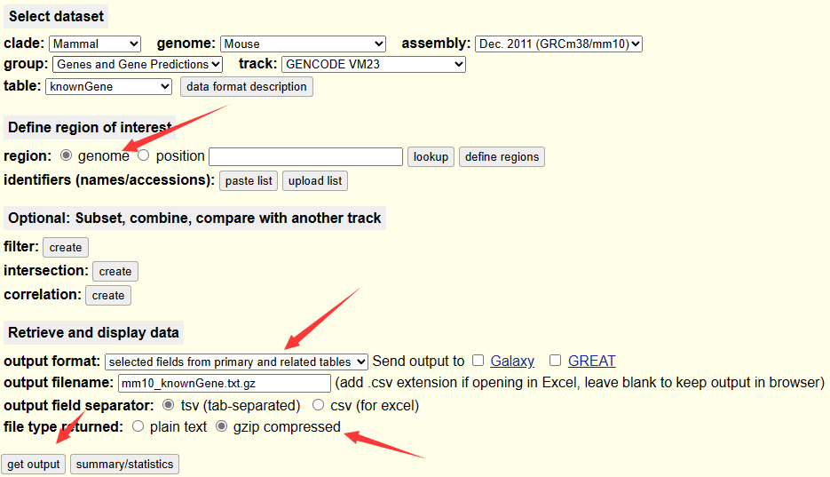
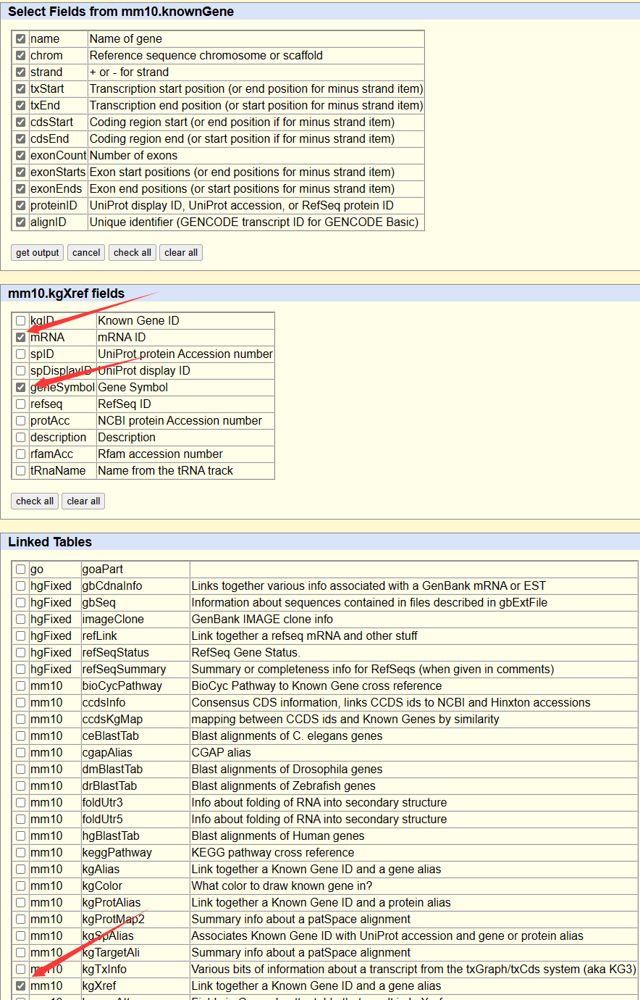
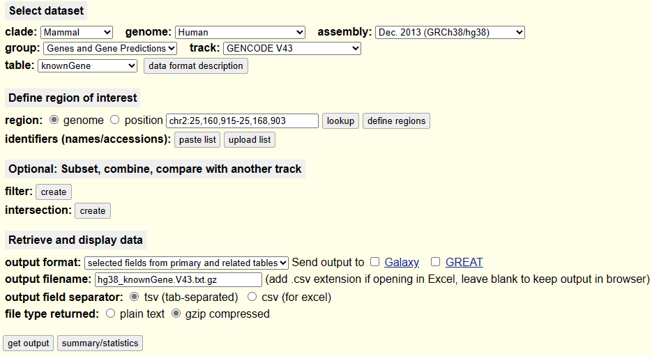
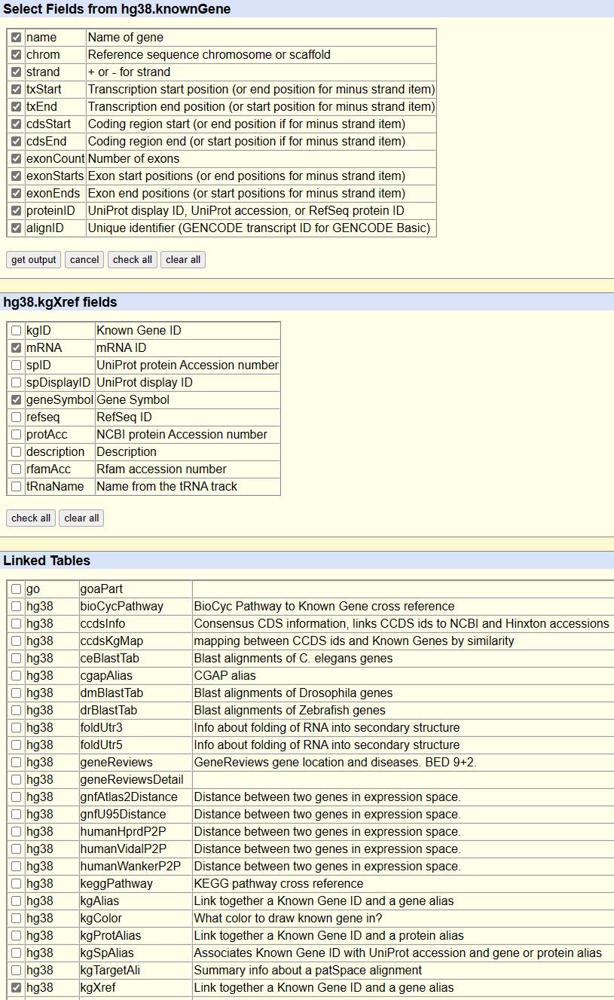
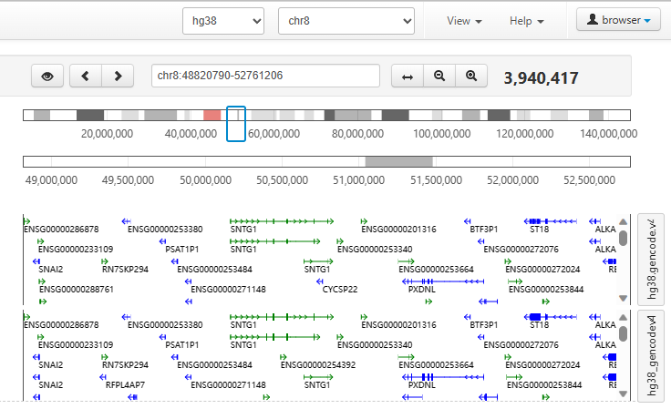
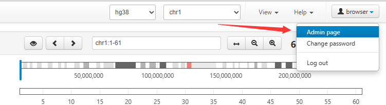
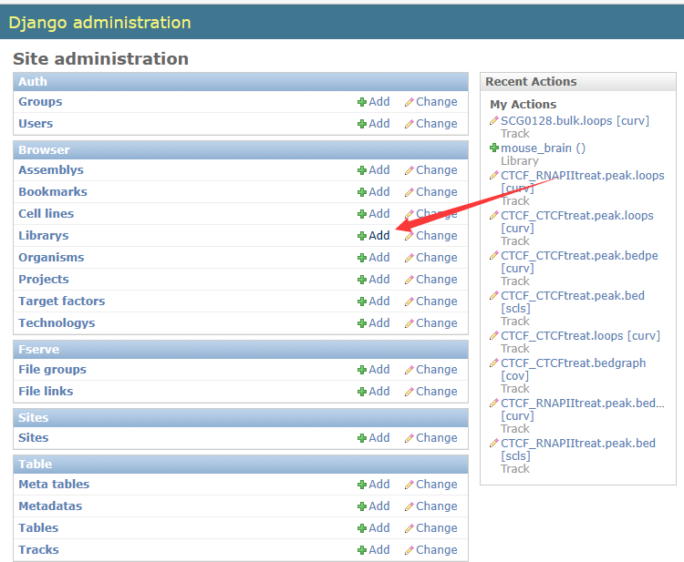
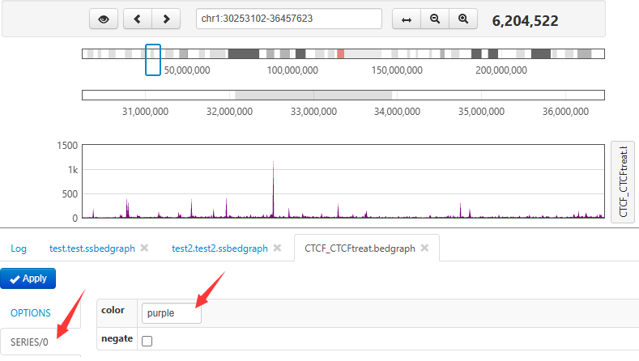
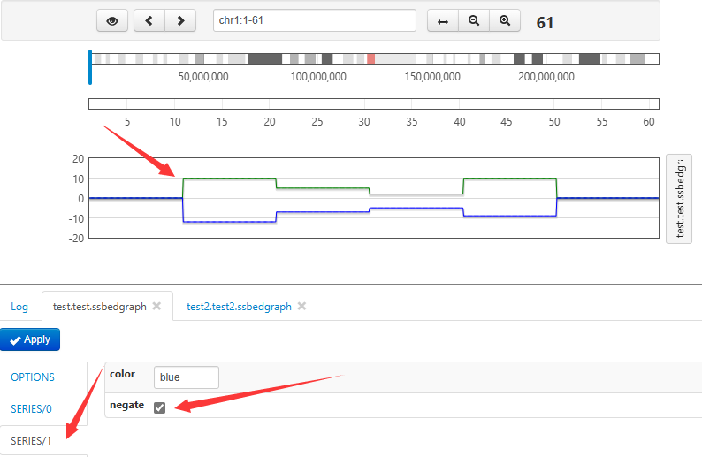
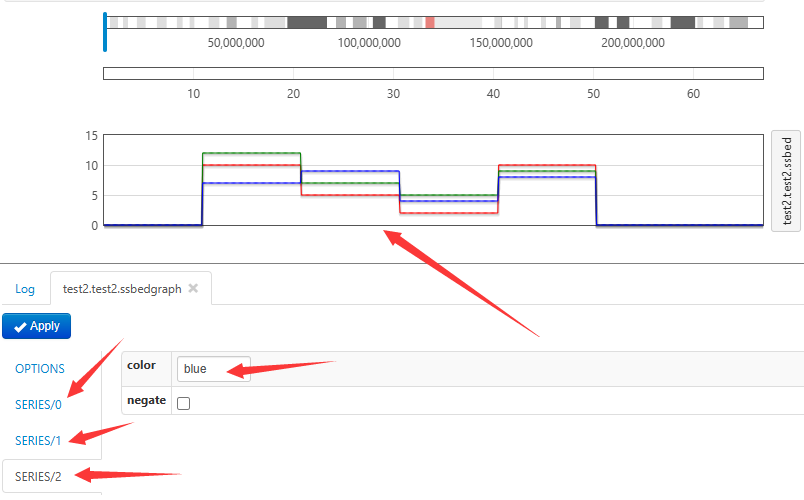

## basic browser
Basic browser manual

----------------------------

## Install
```
yum install docker
# yum install httpd
# yum install libcgroup
# yum install libcgroup-tools

systemctl start docker.service
systemctl enable docker.service
# systemctl start httpd.service
# systemctl enable httpd.service
# systemctl start cgconfig.service
# systemctl enable cgconfig.service

docker build -t basic-browser . # building
docker run -d --name basic-browser -p 8000:8000 -v mongodb:/data/db -v mysql:/var/lib/mysql  basic-browser # basic browser start

docker exec -it basic-browser /bin/bash # enter basic browser (in docker)
cd /opt/basic/
_py/bin/python manage.py createsuperuser # give username, emall and password
exit

docker stop basic-browser # stop basic browser


docker stop basic-browser 
docker start basic-browser
docker restart basic-browser
```

## Upload assembly

```
docker exec -it basic-browser /bin/bash # enter basic browser (in docker)
cd /opt/basic/data/genome/size

samtools faidx susScr11.fa
cat susScr11.fa.fai | grep -v chrUn | grep -v chrY_NW > susScr11.txt
samtools faidx mm39.fa
cat mm39.fa.fai | grep -v random | grep -v  chrUn > mm39.txt
cat bDroNov1.fa.fai | cut -f 1-2 > bDroNov1a.txt

cd /opt/basic/data/genome/chrband

wget https://hgdownload.soe.ucsc.edu/goldenPath/susScr11/database/cytoBandIdeo.txt.gz
zcat cytoBandIdeo.txt.gz |  grep -v chrUn | grep -v chrY_NW | awk 'BEGIN {FS="\t"}  {if( $1 !~ /'_'/) print $0 }' | awk 'BEGIN {FS="\t"; OFS="\t"}  {if( length($4) == 0) {$4=$4"q"}; print $1,$2,$3,$4,$5 }' | sed s'/cen\t/q\t/'g > susScr11.txt
wget https://hgdownload.soe.ucsc.edu/goldenPath/mm39/database/cytoBandIdeo.txt.gz
zcat cytoBandIdeo.txt.gz | grep -v chrUn | grep -v random | awk 'BEGIN {FS="\t"}  {if( $1 !~ /'_'/) print $0 }' | awk 'BEGIN {FS="\t"; OFS="\t"}  {if( length($4) == 0) {$4=$4"q"}; print $1,$2,$3,$4,$5 }' | sed s'/cen\t/q\t/'g > mm39.txt
cat bDroNov1a.txt | awk -v OFS="\t" '{ print $1,0,$2,"q","gneg" }' > bDroNov1a.txt

exit # exit basic browser 
docker restart basic-browser # restart
```

## 2: Upload gene annotation
#### Prepare gene annotaion file
###### Method1: download from UCSC
1. Open UCSC Table Browser. Fill the form as depicted below, and click "get output"
<br/>
2. Select all fields from knownGene table, select only mRNA and geneSymbol from kgXref table and only kgXref from Linked table.
<br/>
3. Click get output. The download will start. Unzip the file.

For human
<br/>
<br/>
<br/>

###### Method2: generated from gtf file
1. Download [UCSC util tools](https://hgdownload.soe.ucsc.edu/admin/exe/linux.x86_64/)
```
rsync -aP rsync://hgdownload.soe.ucsc.edu/genome/admin/exe/linux.x86_64/ ./
# add PATH
```
2. Convert the gtf file into the above format file
```
gtfToGenePred gencode.v43.basic.annotation.gtf test.genePhred
genePredToBed test.genePhred hg38.gencode.v43.basic.annotation.bed
rm test.genePhred
perl -lane '{@aa=split(/,/,$F[10]);@bb=split(/,/,$F[11]);@s=@bb;@e=@bb;foreach $i (0..scalar(@aa)-1){$s[$i]=$F[1]+$bb[$i];$e[$i]=$s[$i]+$aa[$i]}print "$F[3]\t$F[0]\t$F[5]\t$F[1]\t$F[2]\t$F[1]\t$F[1]\t$F[9]\t".join(",",@s).",\t".join(",",@e).",\t\t\t"}' hg38.gencode.v43.basic.annotation.bed > hg38.gencode.v43.basic.annotation.bed.tmp
grep -w transcript gencode.v43.basic.annotation.gtf | perl -lane 'BEGIN{%h;%count;}{if($_=~/transcript_id "(.+?)".+?gene_name "(.+?)";/){$count{$2}+=1;$h{$1}="$2"};}END{print "$_\t$h{$_}" foreach(keys %h);}' | awk -v OFS="\t" '{if(NR==FNR){a[$1]=$2}else if($1 in a){print $0,a[$1]}}' - hg38.gencode.v43.basic.annotation.bed.tmp | awk -v OFS="\t" 'BEGIN{print "#hg19.knownGene.name\thg19.knownGene.chrom\thg19.knownGene.strand\thg19.knownGene.txStart\thg19.knownGene.txEnd\thg19.knownGene.cdsStart\thg19.knownGene.cdsEnd\thg19.knownGene.exonCount\thg19.knownGene.exonStarts\thg19.knownGene.exonEnds\thg19.knownGene.proteinID\thg19.knownGene.alignID\thg19.kgXref.mRNA\thg19.kgXref.geneSymbol"}{print $0}' > hg38.gencode.v43.basic.annotation.bed
```
#### Upload
```
docker exec -ti basic-browser bash
scp user@ip:annotationfile .

GENE=`/opt/basic/_py/bin/python /opt/basic/console/table_util.py create hg38 "hg38.gencode.v43.basic.annotation.bed" | less -R | sed 's/  */\t/g' | cut -f 2 | head -3 | tail -1`
/opt/basic/_py/bin/python /opt/basic/console/table_util.py load_genes ${GENE} -i hg38.gencode.v43.basic.annotation.bed
/opt/basic/_py/bin/python /opt/basic/console/track_util.py gen_genes hg38

exit
```
<br/>
#### Style (browser -> Admin page -> Tracks)
options
```
"{
    colors: {
        text: function(args) {
            var g = args.element;
            return (g["cosmic_cancer"] || g["cosmic_mutated"]) ? "red" : "black";
        }
    }
}"
```
Track type: Genes

## 2: Add a new assembly.
```
1. Create a new organism
2. Create a new assembly
3. Prepare a file "Pig.txt" with chromosome sizes for genome (the name of the file must be identical to the name of a new assembly)
   chr1 1000
4. 
```


## 3: Upload bedgraph file (don't support bigwig file)
#### Add a new library in basic_browser_web, or choose a library (testupload).
<br/>
<br/>
<br/>
#### Prepare bedgraph file
###### Common (for ChIP-Seq, ChIA-PET ...)
```
pip/conda install deeptools
bamCoverage -b file.bam -o file.bedgraph -of bedgraph -p 10

conda install bedtools samtools
# samtools view -H file.bam | grep SN: | awk -F":" '{split($2,aa,"\t");print aa[1]"\t"$3}' > file.size
bedtools genomecov -ibam file.bam -bg  > file.bedgraph
```
###### Strand-specific RNA-Seq
```
chr1	12200	12250	10	0
chr1	12600	12725	10	0
chr1	12775	12900	10	0
chr1	14350	14400	0	10
chr1	14400	14450	0	10
chr1	14450	14475	0	10
```
```
pip/conda install deeptools
bamCoverage -b file.bam -o file.fwd.bedgraph -of bedgraph -p 10 --filterRNAstrand forward
bamCoverage -b file.bam -o file.rev.bedgraph -of bedgraph -p 10 --filterRNAstrand reverse
cat <(awk -v OFS="\t" '{if($4!=0){print $1,$2,$3,$4,0}}' file.fwd.bedgraph) <(awk -v OFS="\t" '{if($4!=0){print $1,$2,$3,0,$4}}' file.rev.bedgraph) > file.ssbedgraph

conda install bedtools samtools
# samtools view -H file.bam | grep SN: | awk -F":" '{split($2,aa,"\t");print aa[1]"\t"$3}' > file.size
samtools view -b -f 128 -F 16 file.bam > file.fwd1.bam
samtools view -b -f 80 file.bam > file.fwd2.bam
samtools merge -f file.fwd.bam file.fwd1.bam file.fwd2.bam
samtools index file.fwd.bam
bedtools genomecov -ibam file.fwd.bam -bg  > file.fwd.bedgraph
samtools view -b -f 144 file.bam > file.rev1.bam
samtools view -b -f 64 -F 16 file.bam > file.rev2.bam
samtools merge -f file.rev.bam file.rev1.bam file.rev2.bam
samtools index file.rev.bam
bedtools genomecov -ibam file.rev.bam -bg  > file.rev.bedgraph
cat <(awk -v OFS="\t" '{if($4!=0){print $1,$2,$3,$4,0}}' file.fwd.bedgraph) <(awk -v OFS="\t" '{if($4!=0){print $1,$2,$3,0,$4}}' file.rev.bedgraph) > file.ssbedgraph
```
###### Multi-sample data (any data)
```
pip/conda install deeptools
bamCoverage -b file1.bam -o file1.bedgraph -of bedgraph -p 10
bamCoverage -b file2.bam -o file2.bedgraph -of bedgraph -p 10
bamCoverage -b file3.bam -o file3.bedgraph -of bedgraph -p 10
bamCoverage -b file4.bam -o file4.bedgraph -of bedgraph -p 10
......
cat <(awk -v OFS="\t" '{if($4!=0){print $1,$2,$3,$4,0,0}}' file1.bedgraph) <(awk -v OFS="\t" '{if($4!=0){print $1,$2,$3,0,$4,0}}' file2.bedgraph) <(awk -v OFS="\t" '{if($4!=0){print $1,$2,$3,0,0,$4}}' file3.bedgraph) > file.sssbedgraph

cat <(awk -v OFS="\t" '{if($4!=0){print $1,$2,$3,$4,0,0,0}}' file1.bedgraph) <(awk -v OFS="\t" '{if($4!=0){print $1,$2,$3,0,$4,0,0}}' file2.bedgraph) <(awk -v OFS="\t" '{if($4!=0){print $1,$2,$3,0,0,$4,0}}' file3.bedgraph) <(awk -v OFS="\t" '{if($4!=0){print $1,$2,$3,0,0,0,$4}}' file4.bedgraph) > file.ssssbedgraph
```
#### Upload
###### Common (for ChIP-Seq, ChIA-PET ...)
```
docker exec -ti basic-browser bash
scp user@ip:annotationfile .

COV=`/opt/basic/_py/bin/python /opt/basic/console/table_util.py create hg38 -l "testupload" "file.bedgraph" | less -R | sed 's/  */\t/g' | cut -f 2 | head -3 | tail -1`
/opt/basic/_py/bin/python /opt/basic/console/track_util.py gen_cov max ${COV} file.bedgraph

exit
```
###### Strand-specific RNA-Seq
```
docker exec -ti basic-browser bash
scp user@ip:annotationfile .

COV=`/opt/basic/_py/bin/python /opt/basic/console/table_util.py create hg38 -l "testupload" "file.ssbedgraph" | less -R | sed 's/  */\t/g' | cut -f 2 | head -3 | tail -1`
/opt/basic/_py/bin/python /opt/basic/console/track_util.py gen_cov max -C 2 ${COV} file.ssbedgraph

exit
```
###### Multi-sample data (any data)
if you merge n bedgraph, -C must set n ...
```
docker exec -ti basic-browser bash
scp user@ip:annotationfile .

COV=`/opt/basic/_py/bin/python /opt/basic/console/table_util.py create hg38 -l "testupload" "file.sssbedgraph" | less -R | sed 's/  */\t/g' | cut -f 2 | head -3 | tail -1`
/opt/basic/_py/bin/python /opt/basic/console/track_util.py gen_cov max -C 3 ${COV} file.sssbedgraph

exit
```
#### Style (browser -> Admin page -> Tracks)
###### Common (for ChIP-Seq, ChIA-PET ...)
<br/>
###### Strand-specific RNA-Seq
<br/>
options
```
{ "opacity": 0.02, }
```
###### Multi-sample data (any data)
<br/>

## 3: Upload bedpe file
#### Add a new library in basic_browser_web, or choose a library (testupload).
<br/>
<br/>
<br/>
#### Prepare bedpe file
file.bedpe
```
chr1 start1 end1 chr2 start2 end2 score
```
#### Upload
```
docker exec -ti basic-browser bash
scp user@ip:annotationfile .

CLU=`/opt/basic/_py/bin/python /opt/basic/console/table_util.py create hg38 -l "testupload" "file.bedpe" | less -R | sed 's/  */\t/g' | cut -f 2 | head -3 | tail -1`
/opt/basic/_py/bin/python /opt/basic/console/table_util.py load ${CLU} 1:chrom 2:start 3:end 4:chrom2 5:start2 6:end2 7:score -i file.bedpe
/opt/basic/_py/bin/python /opt/basic/console/track_util.py new ${CLU} pcls
/opt/basic/_py/bin/python /opt/basic/console/track_util.py new ${CLU} curv

exit
```
#### Style (browser -> Admin page -> Tracks)
options
```
{
  "opacity": 0.02,
  "outbound": {
    "show": false
  },
"yaxis": {
"log": 10.0 }
}
```
series
```
[{"color": "red"}] 
```
There are two same file name track, we can change one name.

## 4: Upload bed file
#### Add a new library in basic_browser_web, or choose a library (testupload).
<br/>
<br/>
<br/>
#### Prepare bed file
###### Common (for narrowPeak, broadPeak, bed5, bed6, bed9, bed12 ...)
```
chr start end name score
```
###### Motif 
```
chr start end strand
```
#### Upload
###### Common (for narrowPeak, broadPeak, bed5, bed6, bed9, bed12 ...)
```
docker exec -ti basic-browser bash
scp user@ip:annotationfile .

BED=`/opt/basic/_py/bin/python /opt/basic/console/table_util.py create hg38 -l "testupload" "file.bed" | less -R | sed 's/  */\t/g' | cut -f 2 | head -3 | tail -1`
/opt/basic/_py/bin/python /opt/basic/console/table_util.py load ${BED} 1:chrom 2:start 3:end 4:name 5:score -i file.bed
/opt/basic/_py/bin/python /opt/basic/console/track_util.py new ${BED} scls

exit
```
###### Motif
```
docker exec -ti basic-browser bash
scp user@ip:annotationfile .

BED=`/opt/basic/_py/bin/python /opt/basic/console/table_util.py create hg38 -l "testupload" "file.bed" | less -R | sed 's/  */\t/g' | cut -f 2 | head -3 | tail -1`
/opt/basic/_py/bin/python /opt/basic/console/table_util.py load ${BED} 1:chrom 2:start 3:end 4:strand -i file.bed
/opt/basic/_py/bin/python /opt/basic/console/track_util.py new ${BED} scls

exit
```
#### Style (browser -> Admin page -> Tracks)
###### Common (for narrowPeak, broadPeak, bed5, bed6, bed9, bed12 ...)
options
```
{
  label: "${name}",
  tooltip: "${seq} [${start}-${end}: (${strand})]",
  orderBy: "name",
  colors: { _: function(args) {
    var com = args.comp, cl = args.cluster;
    if (cl.strand=="+") return "red";
    else  return "red";} 
  },
  "showLabel": true, 
  "glyph": {
    "height": 40.0,
      hpad: -1, 
  }
}
```
###### Motif
options
```
{ colors: { _: "red"}, }
```


```
docker save basic-browser -o basic-browser.tar
gzip basic-browser.tar
```


# Basic Browser

## Basic Browser can take ChIA-PIPE outputs: https://github.com/TheJacksonLaboratory/chia_pipe

## Running Basic Browser
Below are the instructions to run Basic Browser docker image.

## Install Docker
 - [Install Docker for Mac](https://docs.docker.com/v17.09/docker-for-mac/install/)
 - [Install Docker for Windows](https://docs.docker.com/v17.09/docker-for-windows/install/)
 - [Install Docker for Ubuntu](https://docs.docker.com/v17.09/engine/installation/linux/docker-ce/ubuntu/#extra-steps-for-aufs)

## How to build the Basic Browser Docker image
```sh
git clone https://github.com/TheJacksonLaboratory/basic-browser.git
cd basic-browser
docker build -t basic-browser .
cd ..
```

## How to run Basic Browser
This creates a mongodb and mysql Docker volumes, which is useful for data persistence
```sh
docker run  -d --rm --name basic-browser \
       -p 8000:8000 \
       -v mongodb:/data/db \
       -v mysql:/var/lib/mysql \
       basic-browser
```
The basic browser should be running at localhost:8000. To upload track and data into the Basic Browser, a new TTY terminal must be opened in the container.
```sh
docker exec -ti basic-browser bash
```

## Create a username and password through the terminal the first time
```sh
# this should create the superuser 'root'
cd /opt/basic/
$BASIC_DIR/_py/bin/python manage.py createsuperuser
```

## About Data persistence
When you ran the above command to start Basic browser, it created two volumes mongodb and mysql. You can see the volumes using the command `docker volume ls`. For the data to persist between sessions and between containers, make sure you dont delete these volumes. If you need to delete the volumes for various reasons, please run 'docker volume rm mysql mongodb'.

## To delete the basic browser container
```
docker rm -f $(docker ps --filter name=basic-browser -q)
```

## To stop the basic browser container
Stopping the container will remove the container, as we are running the container with "--rm" option
```
docker stop basic-browser
```

## To restart Basic Browser
```sh
docker restart basic-browser
```

## To make sure mysql, mongod, and basic browser are running
```sh
supervisorctl status all
```

# A note about passwords
The mysql root password is not set. If you would like to set the root password, follow these steps
```sh
# Login to the machine
docker exec -ti basic-browser bash

# Update the mysql password
mysql -u root -p
mysql> use mysql;
mysql> update user set password=PASSWORD('your_new_password') where User='root';
mysql> flush privileges;
```

## Genome Installation File Download Links

(1) Genome Annotation File: http://genome.ucsc.edu/cgi-bin/hgTables

(2) Go Term File: http://www.geneontology.org/doc/GO.terms_alt_ids

(3) Gene Association File: 

human: ftp://ftp.ebi.ac.uk/pub/databases/GO/goa/HUMAN/goa_human.gaf.gz

fly: ftp://ftp.ebi.ac.uk/pub/databases/GO/goa/FLY/goa_fly.gaf.gz


## Install Genome Assembly on Basic Browser
(1)Make sure Basic Browser is running at localhost:8000, and you are able to login using your username and password, and a TTY terminal is opened in the container.

(2)Make sure your files to upload are accessible within the basic browser session. To mount the files in ~/Documents/BasicBrowser/
```
docker run  -d --rm --name basic-browser -p 8000:8000 \
-v ~/Documents/BasicBrowser/:/Documents -v mongodb:/data/db \
-v mysql:/var/lib/mysql \
basic-browser
```
The files in ~/Documents/BasicBrowser/ will be accessible in /Documents inside basic browser docker

(3)To create a folder to save gene annotation, go to admin page -> Librarys -> Add library -> Create a library name (for example, "annotation") -> save

(4)Install the genome assembly
```
source /opt/basic/_py/bin/activate
_py/bin/python console/table_util.py create hg19 "UCSC Known Genes (hg19)"
ID=1
_py/bin/python console/table_util.py load_genes ${ID} -i /Documents/data/hg19_known_genes.txt --assoc /Documents/data/gene_association.goa_human --terms /Documents/data/GO.terms_alt_ids
_py/bin/python console/track_util.py gen_genes hg19
```

## Upload Tracks to Basic Browser
(1)Make sure your files to upload are accessible within the basic browser session. To mount the files in ~/Documents/BasicBrowser/
```
docker run  -d --rm --name basic-browser -p 8000:8000 \
-v ~/Documents/BasicBrowser/:/Documents -v mongodb:/data/db \
-v mysql:/var/lib/mysql \
basic-browser
```
The files in ~/Documents/BasicBrowser/ will be accessible in /Documents inside basic browser docker

(2)To create a folder to organize tracks, go to admin page -> Librarys -> Add library -> Create a library name (for example, "test_upload") -> save

# Upload Coverage Track 
(1) To upload the coverage track, first create a table for coverage, select a folder ("test_upload"), and give the name of the track ("GM12878_RNAPII_coverage")
```
alias TABLE="/opt/basic/_py/bin/python /opt/basic/console/table_util.py" 
alias TRACK="/opt/basic/_py/bin/python /opt/basic/console/track_util.py"
TABLE create hg19 -l "test_upload" "GM12878_RNAPII_coverage"
```
(2) Then you will get a TABLE ID for this track, and save the ID to the corresponding variable:
```
COV=2
```
(3) Upload coverage track:
```
TRACK gen_cov max ${COV} /Documents/GM12878_RNAPII_insitu.for.BROWSER.bedgraph
```
# Upload Peak Track 
(1) To upload the peak track, first create a table for peak, select a folder ("test_upload"), and give the name of the track ("GM12878_RNAPII_peak")
```
alias TABLE="/opt/basic/_py/bin/python /opt/basic/console/table_util.py" 
alias TRACK="/opt/basic/_py/bin/python /opt/basic/console/track_util.py"
TABLE create hg19 -l "test_upload" "GM12878_RNAPII_peak"
```
(2) Then you will get a TABLE ID for this track, and save the ID to the corresponding variable:
```
BED=4
```
(3) Upload peak track:
```
TABLE load ${BED} 1:chrom 2:start 3:end -i /Documents/GM12878_RNAPII_insitu.for.BROWSER.spp.z6.broadPeak
TRACK new ${BED} scls
```
# Upload Loop Track 
```
alias TABLE="/opt/basic/_py/bin/python /opt/basic/console/table_util.py" 
alias TRACK="/opt/basic/_py/bin/python /opt/basic/console/track_util.py"
TABLE create hg19 -l "test_upload" "GM12878_RNAPII_loop"
CLU=3
TABLE load ${CLU} 1:chrom 2:start 3:end 4:chrom2 5:start2 6:end2 7:score -i /Documents/GM12878_RNAPII_insitu.e500.clusters.cis.BE3
TRACK new ${CLU} curv
```
# Configure Loop Track
Go to Tracks in Admin page and select the loop track you just uploaded, under Metadatas "Key" and "Value", set: 

Key="options",
Value=
{
  "opacity": 0.02,
  "outbound": {
    "show": false
  },
"yaxis": {
"log": 10.0 }
}

Go to the next row,

Key="series",
Value= [{"color": "red"}]

